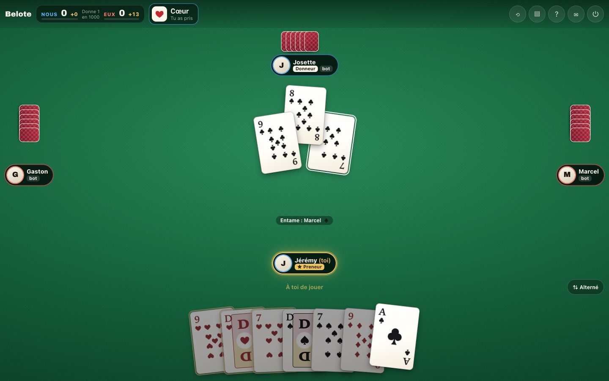
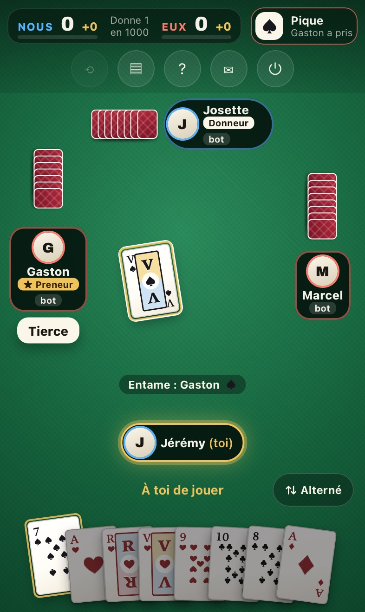
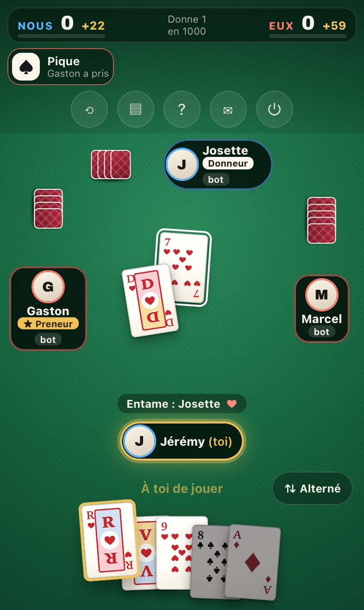
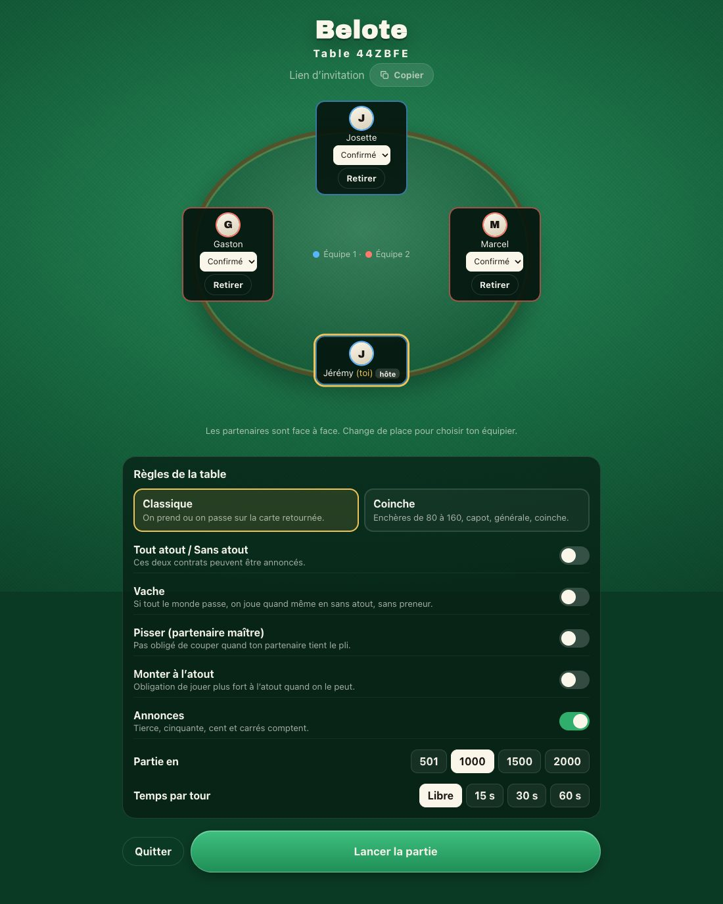

<p align="center">
  
</p>

<h1 align="center">Belote Multiplayer</h1>

<p align="center">
  French belote for four seats, online, with friends or bots.<br />
  Classic or coinche, house rules as table options, voice chat built in.
</p>

<p align="center">
  
</p>

<p align="center">
  
  &nbsp;
  
</p>

## Features

- **Two variants**: classic (take or pass on the turned card) and coinche (auction from 80 to générale, coinche and surcoinche).
- **House rules per table**: tout atout / sans atout, vache, pisse, must overtrump, declarations, target score, turn clock.
- **Bots** in three levels fill any empty seat; **Play against the computer** opens a table with three of them.
- **Invite by link** or six-character code; partners sit face to face and pick their seats in the lobby.
- **At the table**: live hand points next to the score, who led the trick and the suit led, the score sheet and the last trick on demand.
- **Hand sorting**: alternating colours (default), trump on the right, fixed order or unsorted, remembered per device.
- **Phone first**: portrait and landscape layouts, notch aware, installable on the iOS home screen.
- **Voice chat** over a WebRTC mesh that never touches the server.
- **French and English** interface.

The server owns the state and the rules and sends each player only what that player may see: opponents' cards never cross the wire.

<p align="center">
  
</p>

## Rules

| Variant | Bidding                                                                                                   |
| ------- | --------------------------------------------------------------------------------------------------------- |
| Classic | 5 cards dealt plus a turned card. Round one takes the turned suit, round two any other suit (or AT / SA). |
| Coinche | 8 cards dealt, auction from 80 to 160 then capot (250) and générale (500). Coinche x2, surcoinche x4.     |

| Option                  | Default | Effect                                                                                                                          |
| ----------------------- | ------- | ------------------------------------------------------------------------------------------------------------------------------- |
| Tout atout / sans atout | off     | AT and SA are biddable. Both are scored out of 162 like a suit contract.                                                        |
| Vache                   | off     | When everyone passes, the hand is played in sans atout without a taker; each team keeps its points. Off: redeal.                |
| Pisse                   | on      | You may discard instead of trumping when your partner holds the trick.                                                          |
| Must overtrump          | off     | A trump played on a trump must beat it when possible.                                                                           |
| Declarations            | on      | Tierce 20, cinquante 50, cent 100, carrés (J 200, 9 150, A/10/K/Q 100), declared on the first trick. Only the best team scores. |
| Target                  | 1000    | 501, 1000, 1500 or 2000.                                                                                                        |
| Turn clock              | off     | 15, 30 or 60 seconds per move.                                                                                                  |

Always on: belote-rebelote (20, announced automatically), dix de der, capot (250), dedans (the defence takes 162 plus every declaration) and litige (points held in reserve for the next hand).

| Bot level | Plays                                                                                                               |
| --------- | ------------------------------------------------------------------------------------------------------------------- |
| Easy      | a random legal move                                                                                                 |
| Normal    | bids from hand strength, plays by heuristics                                                                        |
| Hard      | bids like normal, then plays each card against 24 simulated deals of the hidden hands and keeps the best on average |

## Run it locally

**Node 26**, pinned in `.nvmrc`.

```bash
npm install
npm run build                     # once, so the server has dist/ to run
npm start -w @belote/server       # API and WebSockets on http://localhost:5050
```

Second terminal, for the client with hot reload:

```bash
npm run dev -w @belote/web        # http://localhost:5173, proxies /socket.io and /healthz to 5050
```

Serving the built client from the server, reachable from a phone on the same network:

```bash
LAN_IP=192.168.1.12
PORT=5050 \
STATIC_ROOT=$PWD/apps/web/dist \
CORS_ORIGIN=http://localhost:5050,http://$LAN_IP:5050 \
npm start -w @belote/server       # then open http://192.168.1.12:5050 on the phone
```

| Variable      | Default | Purpose                                          |
| ------------- | ------- | ------------------------------------------------ |
| `PORT`        | `5050`  | HTTP and WebSocket port                          |
| `STATIC_ROOT` | unset   | Serve the built client from this directory       |
| `CORS_ORIGIN` | unset   | Comma-separated origins allowed to open a socket |

Rate limits, room cap, TURN and logging settings are read in `apps/server/src/config.ts`. Restart the server after every `npm run build`: it lists the static files once, at startup.

| Script                 | What it does                                               |
| ---------------------- | ---------------------------------------------------------- |
| `npm run verify`       | lint, typecheck and unit tests                             |
| `npm run format:check` | Prettier check, run in CI                                  |
| `npm run watch`        | `tsc --build --watch` while editing server code            |
| `npm run e2e`          | Playwright against a real build (Chrome and iPhone WebKit) |

## Deploy it

```bash
docker compose up --build      # then open http://localhost:5050
```

Behind Traefik, `compose.traefik.yaml` is ready to use: replace the hostname, the cert resolver and the network name, then `docker compose -f compose.traefik.yaml up -d`. It also carries an optional `coturn` service for players behind a symmetric NAT.

**One replica, always.** Game state lives in memory, so two processes would each hold half the rooms. A restart drops games in progress.

**Voice chat needs HTTPS.** `getUserMedia` only exists in a secure context; `localhost` is the only exemption.

## Project layout

| Path                | Contents                                                   |
| ------------------- | ---------------------------------------------------------- |
| `packages/engine`   | Pure rules and bots, no I/O                                |
| `packages/protocol` | Views, events and Zod schemas shared by server and client  |
| `apps/server`       | Fastify and Socket.IO: rooms, timers, the only state owner |
| `apps/web`          | Vite and React client                                      |
| `e2e`               | Playwright suites                                          |

## Licence

ISC. See [LICENSE](LICENSE).
